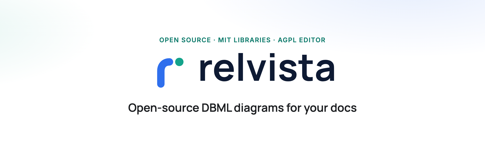

<p align="center">
  <picture>
    <source media="(prefers-color-scheme: dark)" srcset="assets/banner-dark.png">
    
  </picture>
</p>

**relvista** turns [DBML](https://dbml.dbdiagram.io/docs/) into entity-relationship diagrams you can edit, share and embed. It reads the same DBML as dbdiagram.io, keeps your `.dbml` file byte-for-byte untouched, and stores table positions in a small sidecar file that sits next to it in Git.

<p>
  <a href="https://relvista.org/editor/"><b>Open the editor</b></a> ·
  <a href="https://relvista.org/"><b>Documentation</b></a> ·
  <a href="https://github.com/relvista/relvista"><b>Source</b></a>
</p>

### What's inside

| | |
|---|---|
| **Editor** | A browser app: DBML on the left, live diagram on the right. Drag tables, auto-layout, export SVG or PNG, import SQL, share by link. No account, no server. |
| **Docusaurus plugin** | Write a ` ```dbml ` code block in your docs and get a diagram. Works alongside your own theme, live code blocks and Mermaid. |
| **Core and renderer** | The parser, layout and SVG renderer as libraries, for building your own tools. |

### Try it in a few lines

```dbml
Table users {
  id integer [pk]
  email varchar [unique, not null]
}

Table orders {
  id integer [pk]
  user_id integer [ref: > users.id]
  placed_at timestamp
}
```

Paste that into the [editor](https://relvista.org/editor/), or put it in a Markdown file in a Docusaurus site with the plugin installed.

### Get involved

Issues and pull requests are welcome in [relvista/relvista](https://github.com/relvista/relvista). npm packages under `@relvista/` are coming with the 1.0 release.

<sub>relvista is an independent project and is not affiliated with dbdiagram.io or Holistics. DBML is an open format by Holistics.</sub>
